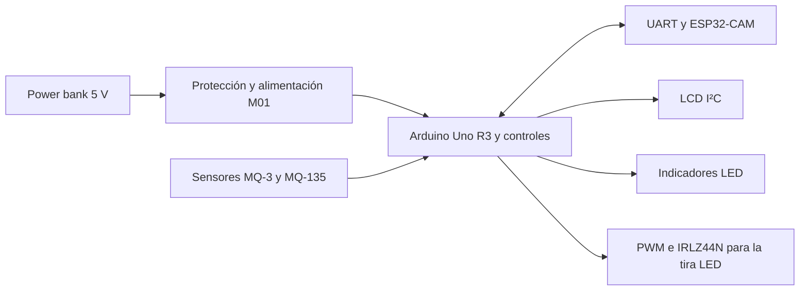

# VFINAL · Electrónica HORIZON

## Esquemáticos y evidencia de montaje

- [Esquemático HORIZON · Equipo 04](Esquematico_HORIZON_Grupo04.pdf). Exportación idéntica a la del Entregable 3, usada para revisar la alimentación, el Arduino, la cámara, los sensores y sus conectores. [Abrir proyecto en EasyEDA Pro](https://u.easyeda.com/join?type=project&key=e0208a9e984bc1ea49f9c1666b53ec42&inviter=e6f5280bd6de4f429c69cd8dc0318dfa) · [Ver montaje de la electrónica en Onshape](https://cad.onshape.com/documents/a05983207418a0e47ec34aae/w/ed2acd99df2cf54146badab0/e/73ba382984dda8bc7a2e9b0c)
- [Documentación y acceso a EasyEDA Pro](<../../../Fundamentos%20de%20dise%C3%B1o/Entregables/Entregable%203/00_DOCUMENTACION_Y_LINKS_ONSHAPE_EASYEDA.md>)
- [Guía de conexiones y soldadura M01](<../../M%C3%B3dulo%20Mec%C3%A1nico/VFINAL/Onshape/Ensamble/HORIZON%20%E2%80%93%20Gu%C3%ADa%20de%20conexiones%20y%20soldadura.pdf>)
- [Esquema electrónico del proyecto.pdf](<Esquema%20electr%C3%B3nico%20del%20proyecto.pdf>). Archivo original reubicado. Su cajetín corresponde al ejemplo de rehabilitación con Arduino Nano 33 IoT.

La ficha solicitada para Rev E indica **7 bloques funcionales, 26 componentes y 24 redes**. La guía física de soldadura M01 enumera **26 redes**, 70 cortes, 50 puentes y 45 cables externos. Ambos recuentos requieren cotejo con la versión del esquemático usada para fabricar.

## Siete bloques de hardware

| Bloque | Función y referencias |
| --- | --- |
| Alimentación | Power bank 5 V, J01, fusible PTC F1, SW1 en J02, C1/C2 y jumper JP1. |
| Control y arnés | Arduino Uno R3, J13 de 16 vías y entradas de pulsador J10 y reed J11. |
| UART y visión | ESP32-CAM por J03. En el montaje M01, U8 TXS0108E adapta 5 V y 3,3 V. |
| Sensado | MQ-3 y MQ-135 por J04/J05 hacia A0/A1. |
| Pantalla | LCD 16 × 2 por I²C a través de J06. |
| Indicadores | LEDs verde, amarillo y rojo por J07–J09 y resistencias de 220 Ω. |
| Iluminación y potencia | D9 PWM, R6 de 220 Ω, R7 de 10 kΩ, Q1 IRLZ44N y tira LED de 5 V por J12. |

## Mapa de pines del Arduino Uno R3 en el arnés J13

| J13 | Arduino | Uso |
| --- | --- | --- |
| 1 | 5V | Alimentación del Arduino vía JP1. |
| 2 | GND | Tierra común. |
| 3 | 3V3 | Alimentación del lado A de U8. |
| 4 | A0 | Señal analógica MQ-3. |
| 5 | A1 | Señal analógica MQ-135. |
| 6 | A4 | SDA de LCD. |
| 7 | A5 | SCL de LCD. |
| 8 | D2 | Pulsador INICIAR, activo en bajo. |
| 9 | D3 | Reed de puerta, entrada con pull-up. |
| 10 | D4 | Indicador verde. |
| 11 | D5 | Indicador amarillo. |
| 12 | D6 | Indicador rojo. |
| 13 | D9 | PWM de la tira LED. |
| 14 | D10 | RX de SoftwareSerial. |
| 15 | D11 | TX de SoftwareSerial. |
| 16 | — | Libre. |

## UART y potencia

La guía de soldadura cruza Arduino D11 TX → U8 → ESP32-CAM GPIO14 RX, y ESP32-CAM GPIO15 TX → U8 → Arduino D10 RX. La variante con divisor **1 kΩ / 2 kΩ** reduce una salida TX de 5 V a aproximadamente 3,33 V. El resistor de 1 kΩ va entre TX del Uno y el nodo RX de la cámara. El de 2 kΩ va de ese nodo a GND común. Esto solo describe el sentido Uno → cámara. El montaje de la guía usa U8 para ambos sentidos.

En J12 la tira recibe +5 V. El IRLZ44N conmuta su retorno en el lado bajo con PWM desde D9. R6 está en serie con la compuerta y R7 la mantiene a GND con la señal sin activar.
